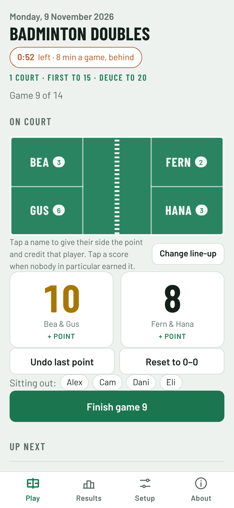
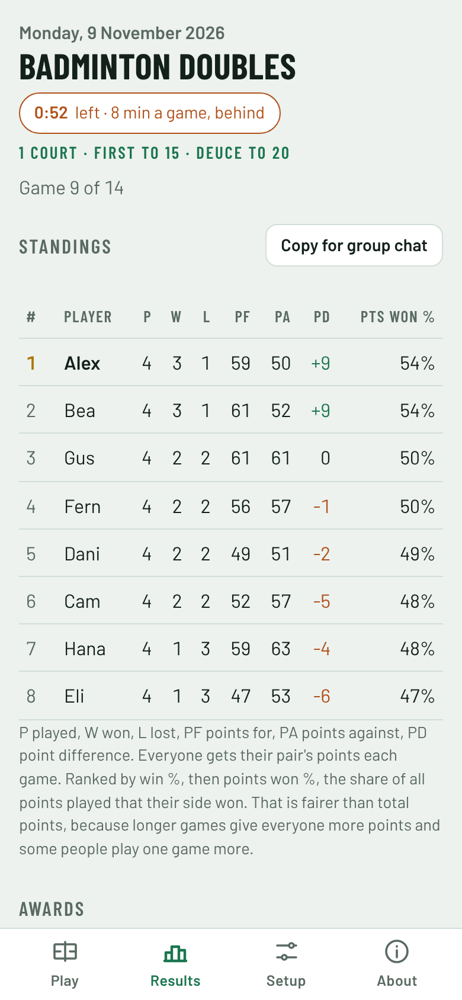
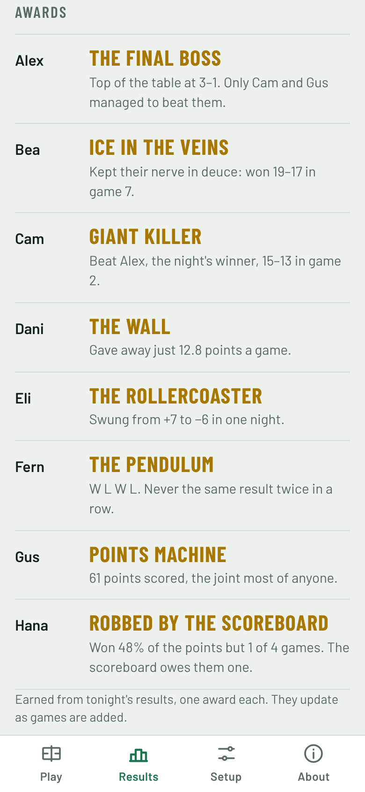
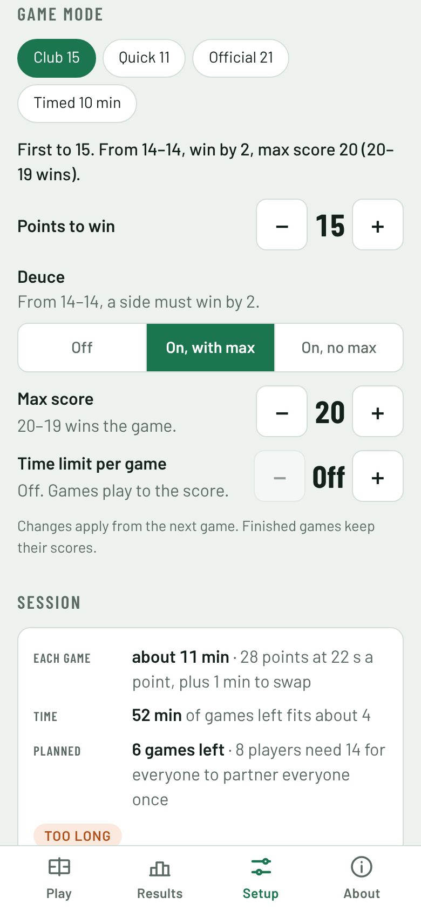

# Badminton Doubles

A badminton doubles scorekeeper for 4 to 8 players sharing one court. It plans who plays with whom so that everyone partners everyone, keeps score from one phone, and turns the night's results into standings, stats and an award for each player.

It is a single HTML file with no backend, account or install. Open it in a phone browser, or add it to your home screen.

  
  
  
  

Screenshots use made-up names and scores.

## Four tabs

| Tab | What's on it |
|---|---|
| **Play** | The court, the score, the game timer and who's up next. Nothing else, so you never scroll while scoring. |
| **Results** | Standings, awards and highlights, with per-player stats, partners and every game folded away underneath. |
| **Setup** | Players, game mode, the session planner, export and import, and reset. A new session starts here and ends with **Start playing**. |
| **About** | What the app is, how to use it, and what the numbers and awards mean. |

The top of every tab shows the day and date of the session, taken from when you start playing, and the rules line under the title is a shortcut to Setup.

## What it does

- **Partner rotation.** Plans the games so every pair partners at least once, games are shared out evenly, and nobody sits out more than they have to.
- **Levels.** Each player can be set as Beginner, Intermediate, Advanced or Pro. The planner shares out games against the top level evenly, so the weakest player doesn't keep getting the strongest opponents.
- **Late arrivals and early leavers.** Mark someone as here or not here and the remaining games are re-planned. The game on court stays as it is unless someone in it leaves.
- **Scoring from one phone.** Tap a player's name to give their side the point and credit that player, or tap a side's score when nobody in particular earned it. **Undo last point** takes back the last tap. Scores follow the game mode you pick, so a game can't be finished on an impossible score.
- **Safety nets.** After **Finish**, an **Undo** button appears for a few seconds. **Reset to 0–0** needs two taps. The game mode is locked while a game is in progress.
- **Game modes.** Points to win, deuce with or without a max score, and an optional time limit per game where a tied score is either a draw or goes to golden point (next point wins).
- **Session planner.** Estimates how long a game takes and how many fit in your booking. When they don't fit, it suggests a lower score, a time limit, or fewer games.
- **Standings.** A league table with P, W, D, L, PF (points for), PA (points against) and PD (point difference), ranked by win %, then by **points won %**, the share of all points played that your side won.
- **Stats.** PF, PA and PD per game, deuce W–L, own points (points a player won personally, tapped on their name), a form chart for each player, and a breakdown of how each player does with each partner and against each opponent.
- **Awards.** One award per player, earned from the night's results.
- **Partners grid.** Shows which pairs have played together, which are coming up, and which won't fit in the games planned.
- **Results list** with undo for the last game.
- **Copy for group chat.** Copies the standings and awards as text, ready to paste.
- **Session clock** for your booking, with a warm-up countdown and the time left per remaining game.
- **Export and import.** Save a session as a `.json` file to keep it or open it on another phone, or copy and paste it as text.
- Works offline once it has been opened online, and follows the phone's light or dark mode.

## Levels

Set each player's level on **Setup → Players**: Beginner, Intermediate, Advanced or Pro. It can be the player's own view or the group's, and it only needs to be right relative to whoever is playing that night. Everyone starts at Intermediate.

Levels never change who partners whom: everyone still partners everyone, game counts stay even, and nobody sits out twice in a row (with up to 7 players). They only decide who plays against the strongest players:

- Games against the top level are shared out evenly. With one top-level player among 7, everyone faces them exactly twice.
- The lowest level never faces the top level more than anyone else.
- If everyone is at the same level, the rule switches off and the plan is the same as before.

Change a level at any time and the games after the one on court are re-planned. Before **Start playing**, the first game can change too. Levels are kept when you reset the session and are saved in exported files.

With 8 players, sharing out the top player costs a few extra back-to-back rests, because half the group sits out every game.

## Game modes

Set these on **Setup → Game mode**, or tap a preset:

| Preset | Points to win | Deuce | Time limit |
|---|---|---|---|
| Club 15 (default) | 15 | From 14–14 win by 2, max score 20 | None |
| Quick 11 | 11 | From 10–10 win by 2, max score 15 | None |
| Official 21 | 21 | From 20–20 win by 2, max score 30 | None |
| Timed 10 min | 21 | From 20–20 win by 2, max score 30 | 10 min, tied is a draw |

Each setting can also be changed on its own:

- **Points to win:** 5 to 30.
- **Deuce:** off (first to the target wins), on with a max score, or on with no max.
- **Time limit per game:** off, or 5 to 30 minutes. The timer starts at the first point. When time runs out the side ahead wins. If the score is tied, you choose **Draw** or **Golden point** (the next point wins).

Draws count as half a win in the standings. Changes apply from the game on court, and finished games keep their scores.

## Planning the session

The **Session** section on Setup works out whether your games fit the booking:

- **Session length** is the whole booking, and **warm-up** is the time before the first scored game.
- **Each game** is estimated from the points to win, about 22 seconds a point, and a minute to swap players. After a few games it uses your group's actual pace instead.
- **Rounds** sets how many times everyone partners everyone.

If the games won't fit, it shows a **Too long** warning with one-tap fixes: play to a lower score, add a time limit, or plan fewer games. If there's time left over, it offers to fill it.

## How many games?

Each game uses two partnerships, so pairing everyone once takes:

| Players | Partnerships | Games needed | Games each | Sitting out each game |
|---|---|---|---|---|
| 4 | 6 | 3 | 3 | 0 |
| 5 | 10 | 5 | 4 | 1 |
| 6 | 15 | 8 | 5–6 | 2 |
| 7 | 21 | 11 | 6–7 | 3 |
| 8 | 28 | 14 | 7 | 4 |

The app plans this many games (times the number of rounds) when a session starts. In a two-hour booking at about 10 minutes a game, 14 games for 8 players is tight, and the session planner will suggest a fix. If you plan fewer games, the Partners grid shows which pairs will miss out.

With 6 or 7 players the planner avoids anyone sitting out two games in a row. With 8, half the group sits each game, so a few people sit out twice in a row to fit every partnership in.

## Awards

Each award comes from a rule about the night's results, not from AI, so it works offline. The app gives each player their strongest award, and no two players share one.

| Award | Earned by |
|---|---|
| The Final Boss | Top of the standings |
| Giant Killer | Beating the night's winner |
| Robbed by the Scoreboard | Winning far more points than games |
| Ice in the Veins | Winning games that went to deuce |
| On Fire | The longest winning streak (3 or more) |
| The Finisher | The biggest share of their side's points personally (needs tap-to-credit scoring) |
| Points Machine | The most points scored |
| The Wall | The fewest points conceded per game |
| The Pendulum | Alternating wins and losses all night |
| Strong Finisher | A much better second half of the night |
| Out of the Blocks | A much better first half of the night |
| The Metronome | The steadiest margins |
| The Rollercoaster | The wildest swings between big wins and big losses |
| Iron Lungs | The most total points played |
| The Social Butterfly / The Grafter / The Regular | Fallbacks when nothing else fits |

## Using it at the court

1. Open the site on the phone you'll score with. Use **Add to Home Screen** to get an app icon.
2. On **Setup**, tap **Edit players** to rename people, or add players up to 8. Mark anyone who hasn't arrived as **Not here**.
3. Pick a **Game mode** and check the **Session** planner fits your booking, then tap **Start playing**.
4. On **Play**, start the session clock, score each game and tap **Finish**.
5. If the line-up on court is different from the plan, tap **Change line-up** and swap names. The games after it re-plan around the change.
6. At the end, open **Results** and tap **Copy for group chat** to share the standings and awards.

**Reset session** (on Setup) clears the scores but keeps the players and game mode.

## Your data

Scores are saved in the phone's browser storage (`localStorage`). Nothing is sent anywhere, and nothing is stored in this repository.

- Each phone and browser has its own copy.
- Clearing browser data, or using a private window, loses it.
- To keep a night's results, use **Setup → Export to file**. It saves a file such as `doubles-2026-11-05.json`. **Import from file** loads it back on any phone, after asking before it replaces what's there.
- **Copy as text** and **Paste text** do the same through the clipboard, which is handy between two web pages.

## Hosting on GitHub Pages

1. Push this folder to a GitHub repository. Free GitHub Pages needs the repository to be public.
2. Go to **Settings → Pages**.
3. Under **Build and deployment**, choose **Deploy from a branch**, select `main` and `/ (root)`, and save.
4. After a minute or two the site is live at `https://<username>.github.io/<repository>/`.

Every push to `main` redeploys the site.

## Files

| File | Purpose |
|---|---|
| `index.html` | The whole app: layout, styles and code |
| `sw.js` | Offline support (service worker) |
| `manifest.webmanifest` | App name, colours and icons for Add to Home Screen |
| `icons/` | App icons |
| `docs/` | Screenshots for this README |
| `tests/planner-check.mjs` | Checks the planner: run `node tests/planner-check.mjs` |
| `CLAUDE.md` | Notes for Claude Code: structure, decisions and conventions |
| `.nojekyll` | Tells GitHub Pages to serve the files as they are |

To change the names a new phone starts with, edit `DEFAULT_NAMES` in the script in `index.html`. After you push a change, phones pick it up the next time they open the site with a signal.
